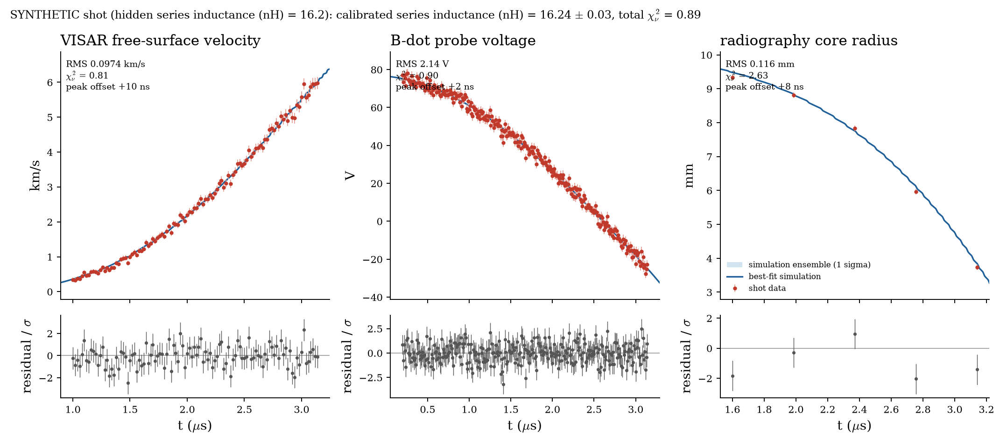
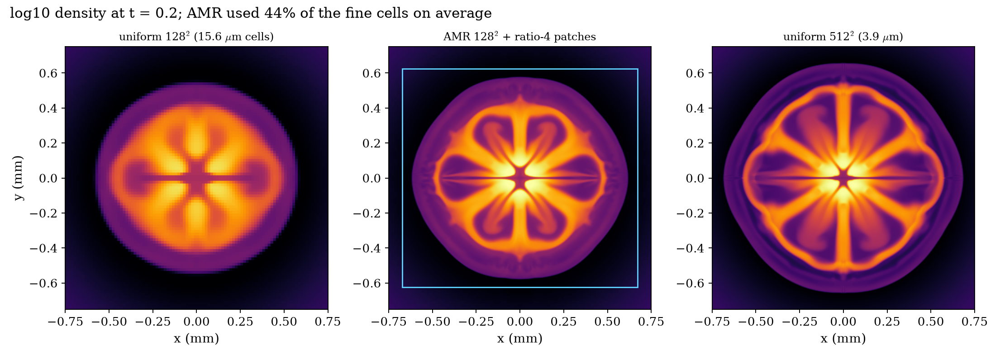
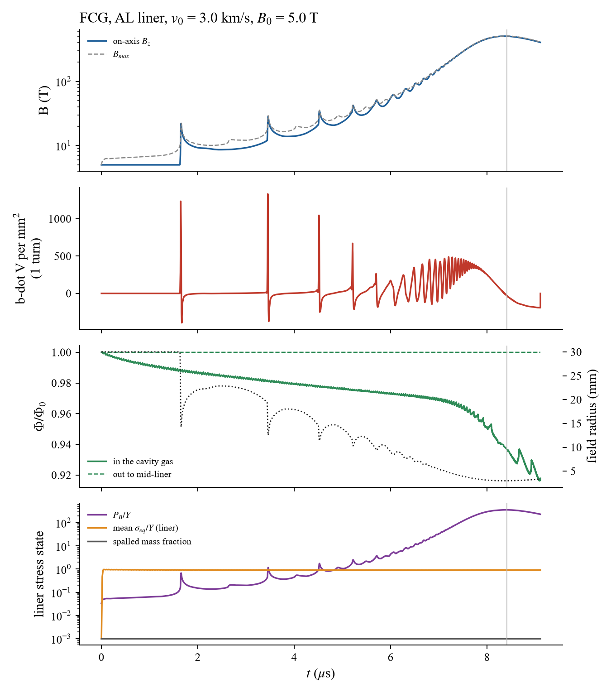
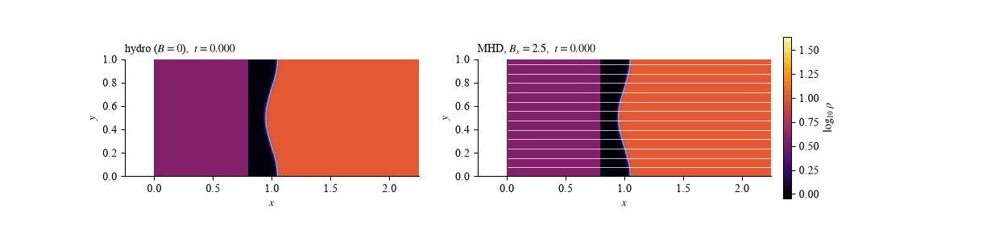

# MagSieve-3D: striped magnetic fields and the Richtmyer-Meshkov instability

A 2D and 3D compressible MHD solver (CuPy + a custom CUDA HLLD kernel) and the parameter study built on it. The study asks whether a spatially striped magnetic field can suppress ("lock") the Richtmyer-Meshkov instability of a shocked density interface while channelling the flow through the weak-field gaps.

**Result in one paragraph.** A uniform shock-parallel field locks the interface, in line with earlier work on magnetised RMI. Striped fields roughen the interface in proportion to their bar/gap contrast: the stripe-scale mode grows as a8 ~ 0.027 dP_B, converged over three resolutions. (An earlier "10% contrast" lock threshold did not survive the convergence study: it was measured against hydrodynamic enstrophy, which keeps growing with resolution.) A shock-parallel field is not compressed by the shock while the gas is, so a striped field that is in pressure balance upstream produces a steady field-aligned shear downstream. Magnetic tension does not resist this shear, and it deforms the interface at the stripe scale. Suppression and collimation therefore work against each other in this regime. Aligning the stripe phase with the interface ripple produces a predictable zero crossing of the RMI mode, but not a lock. In 3D, at the Lundquist number this grid resolves (S ~ 75), the field-aligned shear layers neither tear nor break down. See `paper/` for the write-up, including the grid-convergence study and its limitations.

## Layout

```
sieve/            solver package
  config.py       typed configuration (unknown keys raise ValueError)
  physics.py      CUDA HLLD wrapper, MUSCL, jump conditions, resistive terms, stripe equilibrium
  eos.py          two-material EOS: ideal gas, stiffened gas, Mie-Gruneisen (linear Us-Up)
  units.py        SI helpers: conductivity to code-unit diffusivity, Spitzer coefficient, liner EOS,
                  bremsstrahlung and Braginskii conduction coefficients
  hlld_kernel.cu  HLLD Riemann solver (one thread per face)
  solver.py       MHDSolver (SSP-RK3, constrained transport or GLM + Powell, Cartesian or cylindrical r-z,
                  BCs, energy budget) and PostProcessor
  ct.py           constrained transport: face-centred B, upwinded edge EMFs, vector-potential initialisation
  transport.py    Braginskii Z = 1 coefficients, Nernst field advection, Ettingshausen heat flux
  solver3d.py     MHDSolver3D: unsplit HLLD in x, y, z (same kernel, rotated), z-periodic, 3D seeding,
                  current-density and generated-field diagnostics
  diagnostics.py  mixing, enstrophy, interface spectrum, div B, energy
  circuit.py      RLC drive circuit coupled to an r-z liner (magnetic piston, energy-consistent inductance)
  fld.py          grey flux-limited diffusion radiation (Levermore-Pomraning, implicit CG on the GPU)
  parallel.py     MPI slab domain decomposition of the 2D and 3D solvers (halo and CT edge exchange)
  io3d.py         3D snapshots: VTK ImageData (.vti/.pvd) and HDF5
  tabular.py      tabulated EOS / opacities (SESAME ASCII, .npz) with GPU inversion and analytic fallback
  eos_fused.cu    device two-material / tabulated EOS, called inline by the HLLD kernel and the conversions
  eos_fused.py    its host side: packing, launches
  validation.py   shot data vs simulation: chi^2, RMS, peak offset, timing shifts, calibration, report plot
  amr.py          block-structured adaptive mesh refinement (2D, CT, refluxing, touching patches)
  hall.py         generalized Ohm's law: Hall term, anisotropic (Spitzer) resistivity, on the CT staggering
main.py           CLI: verification tests, single cases, legacy campaign
examples/         MTIF liner flux compression; synthetic magnetic probes (SI units); 3D target asymmetries;
                  MagLIF-style r-z implosion; metal-liner flux compression generator (FCG)
experiments/      sweeps A-H and analysis scripts; data/ holds the saved results
paper/            figure and .docx generators, figures/, magnetic_sieve.docx
scripts/          RMI benchmark runner/plots, render_3d.py (PyVista volume renders + MP4), mpi_check.py
rmi_output_gpu/   figures and GIFs written by the solver
```

## Installation

An NVIDIA GPU with CUDA 12 is required.

```
pip install -e .                  # package + dependencies (pyproject.toml)
pip install -e .[paper]          # also python-docx, for paper/make_paper.py
pip install -e .[viz,mpi]        # 3D rendering (PyVista, ffmpeg, h5py) and MPI (needs an MPI runtime too)
pip install -r requirements.txt  # or the exact tested versions
```

See `CONTRIBUTING.md` for the development workflow.

## Usage

```
python main.py --test all                     # verification suite, ~20 min on a Quadro P1000
python main.py --case striped --B0 3.5 --gap-fraction 0.9 --compare-hydro
python main.py --help
```

`--case` runs a 12 x 2 domain to t = 0.8 and writes figures and 61-frame GIFs to `rmi_output_gpu/`.

### Equation of state

Two materials, selected by the tracer: `eos_fuel` (where it is 0: `ideal` with `gamma`, or `stiffened` with
`p_inf`) and `eos_liner` (where it is 1: `ideal`, `stiffened` with `gamma_liner` and `p_inf_liner`, or
`mie_gruneisen` with `mg_rho0`, `mg_c0`, `mg_s`, `mg_gamma0`). Each law is written as eps = phi1(rho) p + phi2(rho);
mixed cells blend phi1 and phi2 linearly in the tracer, which is then a volume fraction advected
non-conservatively with the face values the energy flux uses (Shyue 1998), so a material interface at uniform
p and u stays in equilibrium. The HLLD kernel takes each face state's internal energy and sound speed from the
EOS; with one ideal gas the solver runs the original code path. Both the 2D and 3D solvers support it. The examples
take an aluminium liner in SI:

```
python examples/nearstar_mtif3_validation.py --eos-liner stiffened                # Al, gamma/p_inf fitted to its Hugoniot
python examples/nearstar_mtif3_validation.py --eos-liner mie_gruneisen            # Al: rho0 2700, c0 5328, s 1.338, Gamma0 2
python examples/mtif_flux_compression.py --eos-liner stiffened --p-inf-gpa 20 --gamma-liner 3.8
```

### Constrained transport and geometry

The magnetic field is face centred and evolved by constrained transport (Gardiner & Stone 2005): edge EMFs
from the HLLD fluxes with upwinded corrections, so the face divergence stays at round-off (about 1e-15) in 2D
and 3D. `set_vector_potential` initialises any field divergence-free; otherwise faces are built from the cell
values. `div_b="glm"` keeps the cell-centred GLM/Powell scheme the published sieve study used (the experiment
scripts and the RMI benchmark pin it, so their results reproduce). `geometry="cylindrical"` runs the 2D solver
in axisymmetric (r, z): x is the radius with a reflecting axis at x = 0, y the axial coordinate, the
out-of-plane components are -v_phi and -B_phi; fluxes are area weighted, the geometric sources
(rho v_phi^2 - B_phi^2 + p_T)/r, -(rho v_r v_phi - B_r B_phi)/r and F_r[B_phi]/r are added, and CT updates
B_z with r-weighted edge EMFs (E_phi = 0 on the axis).

### Thermal conduction

Magnetized electron conduction, q = -[k_perp I + (k_par - k_perp) b b] . grad T with k_par = `cond_kappa0` T^5/2
and k_perp from Braginskii's Z = 1 fit, k_perp/k_par = (4.664 x^2 + 11.92)/(3.1616 (x^4 + 14.79 x^2 + 3.7703)),
x = omega_ce tau_e = `cond_x0` |B| T^3/2 / rho (T = p/rho), in the fuel (liner fraction below
`cond_tracer_max`). At a fuel-liner face the fuel conducts to the liner as an isothermal wall at `cond_wall_T`
(a Dirichlet condition half a cell away, with the fuel's anisotropic k, so a field parallel to the wall
insulates it); the heat goes into the liner cell, so total energy is conserved exactly. `cond_wall="insulating"`
and `cond_perp="simple"` (1/(1 + x^2)) restore the earlier choices; non-periodic domain faces are insulating. Fluxes live on cell faces; the gradient normal to a face is a two-point
difference and the transverse gradients are van Leer limited (Sharma & Hammett 2007), which keeps strongly
anisotropic conduction from creating new temperature extrema. It is a split step integrated with RKL2
super-time-stepping (Meyer, Balsara & Aslam 2014), about sqrt(dt/dt_explicit) stages, so it never limits the
hydrodynamic time step. `units.braginskii_kwargs` gives the Spitzer-Braginskii coefficients in code units (k_par
at 1 keV within 1.1% of the Spitzer value). Ion conduction is left out.

### Nernst and Ettingshausen effects

`nernst_coeff` (from `units.braginskii_kwargs(..., nernst=True)`, or `--nernst` in the examples) adds the
Nernst term to Ohm's law, E_N = -v_N x B with v_N = -(beta_wedge/(e|B|)) grad_perp(kT_e) (Braginskii Z = 1
beta_wedge): the field is carried down the temperature gradient, toward cold walls. It enters CT as an
upwinded edge EMF, so div B stays at round-off, and the time step respects |v_N|. Its Onsager partner, the
Ettingshausen heat flux (beta_wedge kT_e/e) b x J, and the Poynting flux of E_N enter the energy equation as
face fluxes, so total energy is conserved exactly. 2D solver (Cartesian and r-z) and 3D: there the Nernst EMF
-v_N x B sits on all three edge orientations with the same upwinding, and a z-invariant 3D run reduces to the
2D scheme (to 7e-12 over 1240 steps, the two forms summing in a different order).

### Hall term and anisotropic resistivity

`sieve/hall.py` adds to the induction and energy equations the part of the generalized Ohm's law beyond eta J,

    E' = d_i (J x B) / rho + (eta_perp - eta_par) J_perp,     J_perp = J - (b . J) b,

with `hall_di` the ion inertial length at unit density in code units (the Hall term J x B / (e n_e) for Z = 1)
and `eta_perp_ratio` = eta_perp / eta_par (1.96 for a magnetized Z = 1 Spitzer plasma; the configured resistivity,
any `eta_model`, is the parallel value). J and B are formed on the cell corners for E'_z, which joins the CT corner
EMF, and on the faces for E'_x, E'_y, which move B_z in flux form; the energy equation gets the Poynting flux
E' x B, so total energy is conserved to round-off and div B stays at round-off. Whistlers set an explicit time
step, omega = d_i |B| k^2 / rho at the grid scale (kept at 0.75 of the SSP-RK3 imaginary-axis bound at cfl 0.3).
2D Cartesian with CT; the electron pressure gradient term is not included.

### Two-temperature plasma

`two_temp=True` carries the electron entropy s_e = p_e/rho^gamma as an advected scalar (electrons are
compressed adiabatically; shock heating goes to the ions), with theta_e = (1 + Z)/Z p_e/rho and theta_i = (1 + Z)
p_i/rho (`z_ion`). Electron-ion equilibration relaxes theta_e - theta_i exactly at rate (1 + Z) nu, nu =
`te_eq_coeff` rho/theta_e^3/2, at fixed total energy. Conduction, bremsstrahlung, Ohmic and Ettingshausen heating
act on the electrons. `units.twotemp_kwargs` gives the Spitzer equilibration coefficient in code units.

### Viscosity

`visc_coeff` adds Braginskii parallel viscosity, Pi = -3 eta_0 (b b - I/3)(b b : grad v - div v/3), which
reduces to isotropic Navier-Stokes where B = 0. Stresses are face fluxes of momentum and energy (energy
conserved exactly), integrated as an RKL2 split step like conduction (`units.viscosity_kwargs`).

### Liner strength and spall

`strength=True` gives the liner (volume fraction above 0.5) a deviatoric stress (S_xx, S_yy, S_xy) evolved by a
hypoelastic Jaumann rate with shear modulus `shear_modulus`, returned radially to the von Mises surface sqrt(3
J2) = `yield_strength` after each step. The stress enters the momentum and energy fluxes (and the hoop term in
r-z), and the time step uses the longitudinal speed c_L = sqrt(c^2 + 4G/(3 rho)). Where the tension exceeds
`spall_strength` the cell is marked damaged: no tension (p >= 0) and no strength from then on.
`units.strength_kwargs` converts SI moduli. In 3D the stress gains S_xz and S_yz and the Jaumann rotation the
full spin tensor; a z-invariant 3D run matches the 2D solver to 1e-13, and a shear wave along z oscillates at
k sqrt(G/rho) to 0.3%.

### Radiation

Optically thin bremsstrahlung, P = 1.69e-38 Z n_e^2 sqrt(T_eV) W/m^3 (NRL formulary, n in m^-3), acts on the
fuel only: where the liner fraction is below `rad_tracer_max` (0.1) and T is above `rad_T_min`. It is a
split step after each time step using the exact solution at fixed density, sqrt(T) falling linearly in time, so
it is stable for any time step. The energy removed accumulates in `cumulative_radiated_energy` and enters the
energy budget. `units.bremsstrahlung_kwargs` converts to code units; the examples take `--enable-rad`,
`--z-eff`, `--t-rad-min-ev`. At the examples' default parameters the fuel stays below 1 eV and nothing
radiates; a hot dense core does:

```
python examples/mtif_flux_compression.py --enable-rad --v-ref-kms 100 --rho-ref 100
```

### Resistivity

`eta_model` selects `constant` (`eta_resistivity` everywhere, the default), `material` (`eta_fuel` where the
tracer is 0, `eta_liner` where it is 1, log blend between) or `spitzer` (`eta_spitzer` T^-3/2 with T = p/rho
floored at `eta_T_min`, capped at `eta_max`). Face values use the harmonic mean, so a conductivity jump carries
the series resistance of the two cells; the resistive terms stay in face-flux form and conserve energy exactly,
and `cumulative_ohmic_heating` integrates eta J^2. The explicit time step uses the largest eta on the grid. The
examples take SI conductivities:

```
python examples/mtif_flux_compression.py --sigma-liner 3.5e7          # aluminium liner, S/m
python examples/nearstar_mtif3_validation.py --eta-model spitzer --sigma-liner 3.5e7
```

### RLC drive circuit

`sieve/circuit.py` replaces a prescribed liner velocity with a capacitor bank (C, V0, series L0 and R) whose
current runs up an r-z liner and back through a return can at r_return. The circuit is d(LI)/dt = V - RI with
L = L0 + (mu0 l / 2 pi) <ln(r_return / r_out)>, i.e. dI/dt = (V - RI - I dL/dt) / L, integrated by the
trapezoid rule in flux form (exact energy identity for a fixed load). The liner feels the J x B of its surface
current, f = P_B(r) dC/dr on its outer side with P_B = mu0 I^2 / (8 pi^2 r^2), applied as an exact kinetic
energy kick each step. The inductance increment of each step is the one whose mechanical work, (L1 - L0) I0 I1
/ 2 for this scheme, equals the work the grid received, so bank + liner conserve energy to round-off; the
geometric inductance of the liner's actual outer radius is reported alongside (they agree to 1% at 64-96 cells
across the liner region). The FCG and MagLIF examples take `--capacitance-uf`, `--voltage-kv`,
`--inductance-nh`, `--resistance-mohm` and `--r-return-mm`; the liner then starts at rest. Verified against the
analytic RLC discharge (3e-7) and an incompressible thick-shell liner on the same circuit (outer radius to 1.3%
of the distance moved, current to 0.1%).

### Grey flux-limited diffusion radiation

`fld=True` (`units.fld_kwargs`) adds a radiation energy density E_r: dE_r/dt + div(v E_r) = div(D grad E_r) +
c rho kappa_P (a T^4 - E_r), with the Levermore-Pomraning limiter D = c lambda(R) / (rho kappa_R) evaluated on
each face, and power-law Planck and Rosseland opacities (a free-free preset, or your own). Each step advects E_r
with the gas, then solves the stiff part by backward Euler with the emission linearised, the gas temperature
eliminated, and the limiter re-evaluated over a few Picard passes; the symmetric system (volume weighted, so
also in r-z) goes to a matrix-free Jacobi-preconditioned conjugate-gradient solver on the GPU. The final update
is written in face-flux form from the solution, so gas + radiation energy is conserved to round-off whatever
the solver residual. 2D, r-z and 3D. Radiation pressure is left out (fine while E_r/3 << p), and FLD couples to
a single gas temperature (not with `two_temp`).

### Tabulated EOS and opacities

`sieve/tabular.py` reads SESAME ASCII files (EOS table 301; opacity tables 502 Rosseland and 505 Planck, taken
as log10 kappa in cm^2/g against log10 rho in g/cc and log10 T in eV, so check your library's convention) or an
SI `.npz` table (rho, T, p, e, optional cs, kappa_R, kappa_P). Tables are resampled onto a uniform log rho x log
T grid; positive quantities are interpolated in log space, so power laws are reproduced exactly. The lookup
inverts e(rho, T) or p(rho, T) along T at fixed rho (binary search) and interpolates bilinearly; c^2 comes from
the table or from its thermodynamic derivatives. Beyond the table the values are
extrapolated from the edge interval and blended into the analytic liner law (Mie-Gruneisen or stiffened gas)
over two grid cells, so p(e) stays continuous. In the two-material solver the table is the liner in pure liner
cells; mixed cells keep the tangent stiffened gas of the volume-fraction closure (blended over a liner fraction of
0.98 ... 1, with e(p) an exact Newton inverse of p(e) in the blend band). Every example takes `--eos-table` (and
`--eos-table-material` for a SESAME file with several materials) and `--opacity-table` (which turns on FLD with
tabulated kappa_R and kappa_P). No SESAME data ship with the code (LANL distributes them under licence):
`tabular.mie_gruneisen_table` and `tabular.ideal_gas_table` write synthetic tables, which is how this is tested.

The two-material EOS, analytic or tabulated, runs as device functions (`sieve/eos_fused.cu`): the conversions,
the face floors and the HLLD kernel evaluate p(rho, eps), eps(rho, p) and c^2 per cell or face inline (table
search, bilinear interpolation, fallback blend and the blend-band secant all in the thread), and every
`EOS` / `TabularEOS` method on device arrays is one launch. They reproduce the array implementation to
round-off (1e-14 over a run; `SIEVE_ARRAY_EOS=1` switches back to it). `scripts/bench_tabular.py`, a 2D Al
impact on a Quadro P1000:

| grid | analytic MG, array EOS | table, array EOS | analytic MG, device EOS | table, device EOS | table / analytic |
|---|---|---|---|---|---|
| 64^2 | 70.7 ms/step | 873 ms/step (12x) | 15.7 ms/step | 15.4 ms/step | 0.98 |
| 256^2 | 286 ms/step | 759 ms/step (2.7x) | 70.7 ms/step | 68.8 ms/step | 0.97 |

Interpolation is bilinear (bicubic is not implemented).

### Shot calibration against diagnostics

`sieve/validation.py` compares simulated observables with measured traces (VISAR free-surface velocity, B-dot
probe voltage, radiography radii; CSV with time, value, sigma): RMS error, reduced chi^2, and the peak alignment
offset (the delay maximising the cross-correlation of simulation and data). Timing shifts can be fitted as
nuisance parameters with a Gaussian prior from the fiducial uncertainty, and simulated signals pass through the
instruments' response (10 ns FWHM by default). A scan of one model parameter gives the calibrated value: a coarse
scan, a golden-section search inside its best bracket (chi^2 is sharply peaked and not quadratic far from the
minimum), and a least-squares parabola over the whole chi^2 valley, with sigma from Delta chi^2 = 1 inflated by
sqrt(chi^2_min / dof) when the fit is worse than the errors. For a pulsed-power liner the observables come from an
FCG run with the RLC drive: VISAR is the velocity of the liner's outer surface, a B-dot probe in the return gap
sees B_theta = mu0 I / (2 pi r_p) and so measures dI/dt, radiography is the cavity radius.

`examples/experimental_shot_fitting.py` runs the whole chain. Without data files it first makes a synthetic shot
(clearly labelled as such in every output): an FCG run at a hidden series inductance of 16.2 nH sampled like the
instruments, with Gaussian noise and timing offsets drawn from a 5 ns fiducial uncertainty. Scanning 12-22 nH
(5 points, then golden section: 23 runs plus the hidden one) it recovers 16.24 +- 0.03 nH, within 1.1 sigma of the hidden value, with
chi^2_nu 0.81 (VISAR), 0.90 (B-dot) and 2.6 (six radiography frames), 0.89 overall. With real traces:
`--visar v.csv --bdot b.csv --radiography r.csv --param inductance_nh --range 10 25`. Two lessons from building it:
implosion timing makes chi^2 so steep in the circuit inductance (about 0.1 us per nH) that a free timing shift per
diagnostic is nearly degenerate with it, so the shifts need a fiducial prior; and an observable taken from the
tracer-based radius rings at the cell-crossing frequency differently in every run, so VISAR must be the material
velocity at the surface.



### Adaptive mesh refinement

`sieve/amr.py` is a two-level, block-structured AMR for the 2D Cartesian solver (Berger-Colella style):
ratio-r patches (each an `MHDSolver` on a sub-rectangle) take r sub-steps per coarse step, all patches
advancing stage by stage together. Ghost cells and faces come from touching patches (same stage) or from the
coarse level (limited linear in space, linear in time). At each synchronisation the coarse cells next to a
patch are refluxed with the fine fluxes, coarse faces next to a patch get the fine edge EMFs, coarse cells and
faces under a patch become fine averages, and on an edge shared by two patches the lower-index one owns the
faces and corners. Mass, momentum and energy are then conserved exactly and the face divergence stays at
round-off on both levels. The volume fraction is refluxed with both of its terms and prolongation uses one
limiter per cell for all variables, so a material interface at uniform pressure and velocity crosses
coarse-fine boundaries undisturbed (to 1e-13). Patches are regridded from |grad rho| dx / rho, pressure jumps,
interface curvature and field-line curvature flags (optionally inside a region mask), clustered into
rectangles that are split where poorly filled; new patches take the old fine data where they overlap old
ones, and their face fields come from one composite vector potential, so they are divergence-free and agree
on shared edges by construction.

Non-ideal terms are coupled across the levels with the same flux registers:
- resistive MHD: the eta J part of the corner EMF is in the EMF correction, and the resistive Poynting flux
  and the B_z diffusion flux are refluxed;
- liner strength: the 2D deviatoric stress (S_xx, S_yy, S_xy and damage) is prolonged, restricted and
  time-interpolated into patch ghosts, and the stress fluxes of momentum and energy are refluxed;
- Braginskii conduction (RKL2) and grey FLD (backward Euler) are split steps: on a patch they conduct to ghost
  cells from the coarse level at the end of the sub-step, and return their time-integrated face fluxes. The
  RKL2 fluxes go through the same linear recursion as the energy, so the energy change is exactly their
  divergence. These are refluxed into the coarse energy, or into the coarse E_r, which is prolonged and
  restricted like U.

With patches that touch and move, mass, momentum and gas + radiation energy stay conserved to round-off. With
these registers switched off the error is 1e-7 to 3e-4. Viscosity, Nernst, two-temperature and optically thin
radiation are not coupled across levels yet (they raise).

`examples/amr_implosion_demo.py` implodes the 2D magnetized liner (1% mode-6 ripple, 1 mm per code unit) to
t = 0.2 three ways: uniform 128^2 (15.6 um cells), uniform 512^2 (3.9 um) and AMR 128^2 + ratio-4 patches.
The AMR run resolves the instability fingers and spikes that the coarse run washes out (density error against
the 512^2 run 0.40 vs 0.62 for the coarse run; core radius 0.326 between coarse 0.272 and fine 0.365), using
44% of the fine cells on average with up to about 20 patches, energy to 7e-14 and div B at round-off, in 232 s against
273 s for the uniform 512^2 run on a Quadro P1000.

Launch overhead: the coarse step, a fine sub-step of every patch together (three RK stages, the flux registers and
the post-step) and the synchronisation are each recorded once as a CUDA graph and replayed until the next regrid
(dt and the ghost time-interpolation weights are device scalars, ghost frames sit in persistent buffers, the
registers accumulate in place, and a regrid that returns the same boxes keeps the patches). Prolongation is one
kernel, and so are the ghost-ring fill and the register updates. The replay matches the eager code bit for bit.
Before this the patches stepped stage by stage from Python and the same AMR run took 3270 s.
`examples/amr_localized_benchmark.py` times localized problems against the uniform fine grid:

| problem | fine cells | AMR | uniform fine | density L1 vs fine (coarse / AMR) |
|---|---|---|---|---|
| Mach-3 shock on a dense bubble, 256 x 128 + ratio 4 vs 1024 x 512 | 8% | 217 s | 371 s | 0.032 / 0.020 |
| liner implosion, refining only the fuel, 128^2 + ratio 4 vs 512^2 | 8% | 69 s | 111 s | 0.53 / 0.41 |
| liner implosion, refining liner, shocks and core (above) | 44% | 232 s | 273 s | 0.62 / 0.40 |

The remaining cost per fine cell is still about twice a uniform grid's (each patch is its own set of kernels:
with tens of patches the graph holds tens of thousands of small nodes), so AMR pays off when the refined region
is a modest fraction of the domain.



### Multi-GPU domain decomposition

`sieve.parallel.distributed(MHDSolver3D, cfg)` (or `MHDSolver`) run under `mpiexec` splits the grid into x
slabs, one per rank, each keeping the global dx to the last bit. Ghost layers of the cells, the CT face fields
and the liner stress are swapped with the neighbours, the edge EMFs on a shared x-face are taken from the left
rank on both sides (so both update the shared face identically and div B stays at round-off), and dt is the
global minimum. Halos go device to device through NCCL where CuPy has it (Linux), otherwise through MPI staged
in host memory. `scripts/mpi_check.py` compares 2 and 3 ranks with the single-domain solver: 2D Orszag-Tang
with resistivity, aluminium with strength and spall, and a 3D field box agree to 1e-15 to 2e-14 with identical
total energy. Not decomposed yet: r-z geometry, conduction, viscosity and FLD (they raise). Only the MPI path has
been run here (one GPU, Windows, Intel MPI from `pip install impi-rt`); the NCCL path is written but untested,
and the 512^3 scale is a memory estimate (about 1 GB per field copy), not a measured run.

### 3D rendering

`sieve.io3d.Recorder` writes 3D snapshots (density, pressure, temperature, liner fraction, v, B, E_r) as VTK
ImageData with a ParaView `.pvd` series and optionally HDF5. `scripts/render_3d.py` renders them off screen with
PyVista: a ray-cast density volume, the liner isosurface with the quadrant facing the camera cut away, hot-spot
temperature contours and field lines, one PNG per frame and an MP4. `examples/mtif_3d_asymmetry.py --vtk-case
"tilt 2 deg"` records one case and renders it at the end of the run.

```
mpiexec -n 4 python scripts/mpi_check.py                       # decomposition check
python examples/mtif_3d_asymmetry.py --tilts 2 --modes --vtk-case "tilt 2 deg"
python scripts/render_3d.py results/mtif_3d_asymmetry/vtk_tilt_2_deg
python examples/experimental_shot_fitting.py                   # synthetic shot -> calibration report
python examples/amr_implosion_demo.py                          # uniform coarse / fine vs AMR
```

## Performance

The hot paths are fused CUDA kernels (conversions, MUSCL, the CT corner EMF; HLLD reads any axis without
transposing), the right-hand side has no host synchronisation, and in 2D with CT each SSP-RK3 step is captured
once as a CUDA graph and replayed (`use_cuda_graphs`), bit-identical to the uncaptured step. On a Quadro P1000
under Windows a 128 x 128 ideal MHD step went from about 140 ms to 22 ms, a 16 x 4 step from 140 ms to 9 ms.

## Verification

`python main.py --test all` runs the full suite and exits non-zero on failure:

| test | checks |
|---|---|
| brio_wu | Brio-Wu shock tube structure |
| alfven | Alfvén wave convergence order (measured 1.96) |
| reflection | residual of fast and Alfvén pulses after leaving through the outflow boundary (3.5e-5, 7e-10) |
| conservation | energy budget closes to round-off (~1e-14); with CT div B stays at 1e-15 for every field (GLM: 1.3e-2) |
| ct | field-loop advection one period: CT div B 7.5e-15 (GLM 4e-3), 78% of the magnetic energy kept at 128x64; a 3D field from a vector potential in a 3D flow keeps div B at 2.5e-15 |
| cylindrical | r-z: a static magnetized state stays static to 2e-15; cylindrical Noh problem: post-shock density 15.8 (exact 16), shock at r = 0.1975 (0.2), pre-shock density exact; energy budget 5e-14 |
| equilibrium | upstream gas stays at rest for pressure-balanced x stripes to truncation error, second order (1.1e-1, 2.6e-2 c_s at nx = 100, 200); misspelled config keys are rejected |
| z_invariance | z-invariant 3D runs reproduce the 2D solver: ideal, constant eta, and eta varying 8x across the interface |
| alfven_z | Alfven wave along z converges (orders 1.3, 1.9 at nz = 16-64) |
| resistive_z | weak B_x(z) decays as exp(-eta k^2 t) (error 3e-4); Ohmic heating conserves energy |
| resistive_layers | two-layer steady diffusion, eta jumps 4x: piecewise-linear B_z recovered to 3e-4 with harmonic face averaging (arithmetic: 1.7e-2) |
| ohmic | periodic box, eta varying 10x: thermal energy gained matches the integral of eta J^2 to 0.14%, total energy to 2e-14 |
| eos_impact | 10 km/s Al impact: stiffened Al on stiffened Cu vs the exact impedance match, and Mie-Gruneisen Al on Al vs the Us-Up Hugoniot; shock speeds, pressure, densities and velocity within 0.5% |
| eos_interface | Al slab in gas at uniform p and u: volume-fraction tracer keeps p uniform to 1e-9 (round-off times p_inf/p); mass-fraction blending, for comparison, is off by 3e5 p within 0.002 us |
| wall_conduction | fuel slab cooling into a cold liner wall: mean temperature follows the exact series to 0.3%, 10x slower with the field parallel to the wall (k_par/k_perp = 10); with an oblique field (80 deg, k_par/k_perp = 1e4) no liner cell gives heat back to the fuel (without the wall's second-law limit one did) |
| transport | Braginskii fit limits; Nernst: field bumps in B_y (faces) and B_w (cells) travel down a temperature gradient along the exact path to 0.06 cells; Ettingshausen conserves energy to 2e-14 |
| twotemp | theta_e - theta_i relaxes as the exact ODE to 0.3% at fixed energy (1.5e-16); Sod: electron entropy behind the shock equals the upstream value (electrons compressed adiabatically), T_i/T_e >= 1.13 there; bremsstrahlung cools only the electrons |
| viscosity | sound-wave damping from Braginskii parallel viscosity: 4/3 eta k^2/(2 rho) for B along k, 1/3 for B across k, 4/3 (Navier-Stokes) for B = 0, all within 3%; energy 6e-14 |
| strength | stiffened Al, G = 26 GPa, Y = 0.29 GPa: elastic pulse at c_L to 0.2% (not bulk c0); 0.5 km/s impact: elastic precursor at the HEL to 0.9% moving at c_L, plastic wave on the yield surface sqrt(3 J2) = Y and plateau S_xx = -2Y/3 to 0.01%; a bar pulled apart spalls at the centre only; energy budget 9e-15 |
| conduction | hot spot in a field with k_par/k_perp = 1e4: grid-aligned, the spread along and across B equals 2 D t to 0.04% and 1%; at 45 deg the numerical cross-field leakage is 2.7% (64^2) and 0.7% (128^2) of the parallel spread, second order; no new extrema, energy conserved to round-off |
| parity3d | 3D slabs reproduce the 2D solver to round-off for a stiffened Al/Cu impact (5e-14), bremsstrahlung decay (2e-15) and conduction in an oblique field (7e-15) |
| radiation | uniform hydrogen plasma, T0 = 500 eV, n = 1e20 cm^-3: T(t) matches (sqrt(T0) - K t/2)^2 to 1e-14 down to the 10 eV cutoff; E + E_rad conserved to 1e-15; no cooling in liner material or below the cutoff |
| eos_positivity | stiffened Al pulled apart at 5 and 8 km/s (cavitation) and a gas/Al interface: p + p_inf > 0, c^2 > 0, finite state |
| fcg | flux compression generator on a 64 x 4 r-z grid (Al liner, Mie-Gruneisen, strength and spall, CT, resistivity): axis field passes 20 B0 with >80% of the flux left in the cavity, no spall, div B at round-off, energy budget below 1e-12, output files written |
| circuit | RLC discharge vs the exact damped sine (3e-7); an Al liner driven from rest by a 200 uF, 30 kV bank: bank + grid energy to round-off, outer radius and current vs an incompressible thick shell on the same circuit (1.3% of the distance moved, 0.1%) |
| solid_nernst_3d | 3D vs 2D: plastic flow to 1e-13, Nernst + Ettingshausen to 7e-12 (1240 steps), identical spalled regions; a shear wave along z (S_xz) at k sqrt(G/rho) to 0.3%; a field bump on the exact Nernst path along z |
| mpi | 2 and 3 MPI ranks vs one domain: 2D Orszag-Tang with resistivity, Al with strength and spall, 3D field box, to 1e-15..2e-14 with identical total energy and div B at round-off (skipped without mpi4py/mpiexec) |
| fld | equilibration vs the exact ODE (0.7%, energy 5e-15); optically thick Gaussian spreading as 2 D t per direction in 2D, r-z and 3D (0.02%); optically thin front at 0.99 c t; advection with the flow, gas + radiation energy to round-off |
| render3d | 3D snapshots to .vti/.pvd and .h5 and back exactly; off-screen PyVista renders and an MP4 (skipped without pyvista) |
| tabular | SESAME ASCII 301/502/505 write and read back (1e-15); an ideal-gas table reproduces the ideal-gas Sod tube to 1e-13; a Mie-Gruneisen Al table reproduces the analytic 2 km/s impact (shocked p 17.998 vs 17.998 GPa, fields to 2e-4) and p(e) stays continuous into the fallback; the device EOS matches the array EOS on 160k random states (blend band, mixed, off-table) to 3e-10 and over the impact run to 1e-14; FLD with tabulated opacities matches the power laws to 2e-11 |
| validation | analytic signals with known noise: chi^2_nu of the true model 1.001, RMS 1.000 sigma; a 37 ns delay recovered by the cross-correlation offset and the fitted shift to 0.5 ns; a 1-parameter scan recovers the amplitude with the Fisher sigma; CSV round trip |
| amr | ratio-4 patches: periodic MHD box with regridding and three touching patches (edge and corner) conserve mass, momentum and energy to 2e-15 with div B at 5e-15 and shared faces equal; a T-junction of three patches keeps div B at 6e-15 (each shared corner takes the lowest-index patch's EMF once; corrected twice, as before, div B grew to 7e-3); CUDA-graph replay equals the eager run exactly; a gas / stiffened-gas slab crosses fixed coarse-fine boundaries with p and u uniform to 1e-13; a magnetized blast wave has 0.43x the coarse-grid density error with 21% of the fine cells |
| hall | circularly polarized waves along B_0 with d_i k = 1: whistler and ion-cyclotron frequencies k (sqrt(1 + (k d_i/2)^2) -+ k d_i/2) to 8e-5 and 1.5e-3 at 64 cells (second order); a B_z ripple decays at eta_par k^2 (0.3945 vs 0.3948) with its current along B and at 1.96 eta_par k^2 (0.7685 vs 0.7738) across it; Hall + anisotropic resistivity in a sheared periodic box: energy 4e-15, div B 2e-15 |
| amr_physics | resistive, conduction, FLD and strength each with three touching patches moving every 4 steps: conservation 5e-16 to 8e-16 (1e-7 to 3e-4 with the new registers off), div B at round-off; a feature inside one patch matches a uniform fine run to 1e-3 to 1e-4 of the coarse run's L1 error |

## Reproducing the study

```
cd experiments
python sweeps.py C            # one sweep, results in data/exp_C.npz
python sweeps.py all          # sweeps A-H, about 2.7 h
python interface_spectrum.py  # RMI mode vs stripe mode
python enstrophy_location.py  # mixing-layer vs window enstrophy
python initial_conditions.py  # t = 0 fields (Fig. 1, 5)
python equilibrium_convergence.py  # upstream residual vs resolution (Fig. 2a)
python 3d_tearing_sweep.py   # 3D proof of concept, ~20 min (--quick: 2 min)
python 3d_tearing_sweep2.py  # resistive 3D, seed scan + resolution check, ~50 min
python ../paper/make_figures.py
python ../paper/make_paper.py
```

| sweep | question |
|---|---|
| A | small ripple, long domain: field-free-gap stripes vs hydro |
| B | uniform-temperature closure and a uniform-field control |
| C | gap-fraction sweep at B0 = 4 and 6 |
| D | weakest locking uniform field; weak-modulation stripes |
| E | stripe/ripple wavenumber ratio and phase at B0 = 6 |
| F | phase-aligned stripes at 20% and 30% modulation |
| G | resolution check (ny = 100 vs 200) |
| H | figure set: spectrum, enstrophy location, energy budget |

## Multi-physics MTIF capabilities

MagSieve-3D includes physics modules for magnetized target inertial fusion (MTIF) and magnetically driven
shock compression, each verified against an analytic solution in `python main.py --test all`:

- **Shock capturing and exact div B:** HLLD Riemann solver, MUSCL reconstruction, constrained transport: the
  face divergence stays at round-off (1e-15) in 2D, 3D and r-z.
- **Axisymmetric (r, z) geometry:** for MagLIF-style liners without Cartesian grid imprint; verified on the
  cylindrical Noh problem.
- **Variable resistivity:** constant, material-blended (liner/fuel) or Spitzer (T^-3/2 with a temperature floor
  and cap). The resistive terms are face fluxes, so energy is conserved exactly; harmonic face averaging gives
  the correct series resistance across a conductivity jump (two-layer steady diffusion recovered to 3e-4).
- **Two-material EOS:** ideal gas, stiffened gas and Mie-Gruneisen (linear Us-Up) for metallic liners. The
  interface uses a volume fraction advected non-conservatively (Shyue 1998), which keeps a gas/aluminium
  interface at uniform pressure to 1e-9. A 10 km/s aluminium impact matches the exact jump conditions to
  within 0.5%.
- **Optically thin bremsstrahlung:** an operator-split sink using the exact solution at fixed density, so it
  is stable at any time step. In the decay test T(t) matches the analytic solution to 1e-14 and E + E_rad is
  conserved to 7e-16.
- **Two-temperature plasma, Braginskii viscosity, Nernst and Ettingshausen transport.**
- **Liner strength:** von Mises plasticity with a Hugoniot elastic limit, and spall.
- **Flux compression generators:** Al or Cu liners crushing a seed field in r-z, with b-dot probe signals,
  flux retention and liner stress diagnostics (`examples/fcg_flux_compression.py`, below).
- **Magnetized thermal conduction:** anisotropic, k_par ~ T^5/2 along B and Braginskii k_perp across it, with limited transverse gradients and RKL2 super-time-stepping. A hot spot with
  k_par/k_perp = 1e4 spreads along B as 2 D t and stays confined across it; for an oblique field the numerical
  cross-field leakage falls at second order with resolution.

Resistivity, EOS, radiation, conduction, two-temperature and viscosity run in 2D and 3D; z-invariant 3D slabs
reproduce the 2D solver to round-off. Nernst and strength now also run in 3D; r-z geometry is 2D. The example
parameters are
illustrative, not taken from any experiment.

### Examples

```bash
# liner-driven flux compression: stiffened-gas aluminium liner with finite conductivity
python examples/mtif_flux_compression.py --eos-liner stiffened --sigma-liner 3.5e7

# the same at hot, dense core scales (~100 eV), where bremsstrahlung matters
python examples/mtif_flux_compression.py --enable-rad --v-ref-kms 100 --rho-ref 100

# synthetic b-dot probe signals for an MTIF-3-style implosion, Mie-Gruneisen aluminium liner
python examples/nearstar_mtif3_validation.py --eos-liner mie_gruneisen --sigma-liner 3.5e7

# magnetized conduction on a 0.5 mm target at ~100 eV (--braginskii: physical omega_ce tau_e, the
# default; --kappa-ratio R: fix k_par/k_perp = R in the initial fuel instead; --kappa-ratio 1: unmagnetized)
python examples/mtif_flux_compression.py --enable-conduction --v-ref-kms 100 --r-ref-mm 0.5

# 3D target asymmetries: axis tilt and azimuthal liner modes against 2D and 3D references
python examples/mtif_3d_asymmetry.py --tilts 0.5 1 2 --modes 2 4

# MagLIF-style implosion in axisymmetric (r, z) with an axial liner ripple (magneto-Rayleigh-Taylor seed);
# --enable-conduction --nernst --v-ref-kms 100 --r-ref-mm 0.5 adds magnetized transport on a hot small target
python examples/maglif_rz.py

# flux compression generator: a metal liner coasting at v0 squeezes a seed field in r-z (see below)
python examples/fcg_flux_compression.py --liner-material al --b0-tesla 5 --v0-kms 3 --enable-strength
python examples/fcg_flux_compression.py --liner-material cu --enable-strength --out results/fcg_compression_cu
```

With conduction on, the summaries report the heat conducted out of the hot spot (core gas above half the
peak core temperature) as a percentage of its peak thermal energy, and the field's suppression of conduction
there: the sum of grad T . K . grad T over the hot spot with the field off divided by the sum with it on, for
the state at turnaround. In 2D the field is axial, so all in-plane conduction is across B; the fuel conducts
into the liner as an isothermal wall. On the 0.5 mm, 100 km/s target (512^2) the hot spot loses 7.9% of its
peak thermal energy with Braginskii magnetization, and at turnaround the core holds 39.8 units of thermal
energy against 21.9 unmagnetized (`--kappa-ratio 1`): the field keeps 1.8x more heat in the fuel. Without a
field the hot-spot loss is not a useful number: the core is nearly isothermal, so heat crosses the moving
half-maximum surface back and forth and the integral (130x the hot spot's peak energy, more than the whole
system's thermal energy) counts that gross flow, not a net loss; compare core thermal energies instead. At
the examples' default scales (fuel near 0.01 eV) conduction is negligible.

### 3D multi-physics parity and magnetized conduction

The two-material EOS with volume-fraction interfaces, bremsstrahlung and anisotropic conduction all run in
the 3D solver, sharing their kernels with 2D; a z-invariant 3D slab reproduces the 2D solver to round-off
(`--test parity3d`). Conduction follows k_par ~ T^5/2 along B and k_perp = k_par/(1 + (omega_ce tau_e)^2)
across it, with Sharma & Hammett (2007) limited transverse gradients so that strongly anisotropic heat flow
creates no new temperature extrema, and RKL2 super-time-stepping so that it never limits the hydrodynamic time step.

### 3D target asymmetries

`examples/mtif_3d_asymmetry.py` implodes the liner in 3D (64^2 x 32, z periodic) with a uniform axial seed
field, so div B = 0 for any target shape. A tilt is an axis displacement dx(z) = A sin(2 pi z/Lz) whose
largest slope equals the tilt angle (a uniform tilt cannot be periodic); the modes are liner radii
R (1 + 0.02 cos(m phi)). Conduction on, Braginskii magnetization, 0.5 mm / 100 km/s scales:

| case | convergence ratio | peak mean core B / B0 | peak-B spread in z | field tilt (rms B_perp/B_z) | hot-spot conduction loss | field suppression at turnaround |
|---|---|---|---|---|---|---|
| 2D baseline | 5.01 | 21.52 | - | - | 3.64% | 5.2e4 |
| 3D reference | 5.01 | 21.52 | 0 | 0 | 3.64% | 5.2e4 |
| tilt 0.5 deg | 5.01 | 21.51 | 5.5e-4 | 4.3e-3 | 3.91% | 4.2e4 |
| tilt 1 deg | 5.01 | 21.51 | 8.9e-4 | 8.0e-3 | 4.12% | 2.9e4 |
| tilt 2 deg | 5.01 | 21.50 | 1.0e-3 | 1.6e-2 | 4.86% | 1.4e4 |
| m = 2 | 4.73 | 20.96 | 0 | 0 | 4.64% | 1.1e5 |
| m = 4 | 4.48 | 20.39 | 0 | 0 | 4.70% | 5.5e4 |

The unperturbed 3D run matches the 2D baseline exactly. Up to 2 deg, tilt barely changes the compression
(peak field -0.1% at 2 deg) but bends the core field lines in proportion to the tilt, which opens a parallel
conduction path: the field's suppression of conduction in the hot spot falls 3.8x between 0 and 2 deg and the
hot spot's conductive loss rises from 3.6% to 4.9% of its peak thermal energy. The 2% azimuthal modes cost
more peak field (-2.6% for m = 2, -5.3% for m = 4) and raise the loss to 4.6-4.7% through the larger hot-spot
surface, while the field lines stay axial. The axis displacement is at most 0.18 cells at this resolution, so
it is invisible in density slices and shows only in these integrated metrics; energy closes to 3e-14 or
better in every run. The loss counts only cells the scheme conducts as fuel (liner fraction below
`cond_tracer_max`); cells above it are the isothermal wall's heat sink.

## Flux compression generator (FCG)

`examples/fcg_flux_compression.py` models a cylindrical magnetic flux compression generator in axisymmetric
(r, z): a solid aluminium or copper liner, already launched inward at v0 by an explosive or pulsed-power
drive, crushes an axial seed field B0 trapped in its cavity. Constrained transport keeps div B at round-off;
the liner has a Mie-Gruneisen EOS (linear Us-Up Hugoniot), optional von Mises strength and spall
(`--enable-strength`), and its cold metal conductivity (Al 3.5e7, Cu 5.8e7 S/m), with Spitzer resistivity
(capped at `--sigma-min`) in the cavity gas and Ohmic heating everywhere. Each run writes `diagnostics.csv`
(time, on-axis and peak B, the b-dot voltage of a 1 mm^2 loop, flux in the cavity, magnetic pressure over
yield P_B/Y, von Mises stress, spall), `summary.json`, `fcg_signals.png` and `fcg_implosion.gif` (density and
von Mises stress with field lines).

```
python examples/fcg_flux_compression.py --liner-material al --b0-tesla 5 --v0-kms 3 --enable-strength
python examples/fcg_flux_compression.py --liner-material cu --enable-strength --out results/fcg_compression_cu
python examples/fcg_flux_compression.py --quick --check      # 128 x 16 smoke run
```

Liner R0 = 30 mm, 3 mm thick, 20 mm axial period with a 0.5% mode-2 ripple, v0 = 3 km/s at mid-wall, B0 = 5 T,
256 x 128 cells (0.16 mm):

| | Al (6061) | Cu (OFHC) |
|---|---|---|
| turnaround | 8.42 us | 8.46 us |
| peak on-axis field | 506 T (101 B0) | 1079 T (216 B0) |
| field-radius convergence | 10.1 | 14.6 |
| flux left in the cavity at turnaround | 93.6% (ideal MHD: 99.1%) | 93.3% |
| peak b-dot | 1.33e3 T/us (1.3 kV per mm^2 turn) | 1.34e3 T/us |
| peak P_B/Y | 358 | 3926 |
| spalled liner mass | 0 | 0 |
| div B, energy error | 4e-14, 7.9e-13 | 4e-14, 9.2e-13 |



The liner yields within the first 0.1 us and stays plastic (P_B/Y in the hundreds to thousands), so near
peak field it behaves as a fluid and strength matters only early on. The copper liner carries 3.3x the
aluminium's kinetic energy and reaches twice the field. About 5.5% of the cavity flux soaks into the
aluminium liner by resistive diffusion; the ideal-MHD run loses 0.9%, which is the numerical diffusion at
this resolution. The early spikes in the on-axis field are fast magnetosonic waves from the liner focusing
on the axis (the cavity rings); by peak compression the cavity field is uniform. Energy closes to 1e-12 over
13 000 to 15 000 steps: the error grows linearly at about 6e-17 per step, so it is accumulated round-off.

**Pulsed-power drive.** With `--capacitance-uf 200 --voltage-kv 80 --inductance-nh 15` (640 kJ) an aluminium liner
at rest (R 10-11 mm, 10 mm long, 5 T seed, strength on, 192 x 32 cells of 0.073 mm) is driven by the circuit
instead: the current peaks at 8.0 MA at 2.5 us with 109 GPa of drive pressure, the liner takes 7.2% of the bank
as kinetic energy (21% of the bank is lost in the 1 mOhm series resistance), and the axis field reaches 2020 T
at 3.44 us. Bank + grid energy closes to 1e-14; the hydrodynamic energy error is 1.2e-11 after 50 440 steps
(round-off accumulation, 2.4e-16 per step), and the inductance from the work done and from the liner's radius
stay within 2.4%. At turnaround the field radius is 0.50 mm, only 7 cells, against a 9.5-cell liner surface,
so that peak field is resolution-limited (`results/fcg_rlc`).

Limits: the coasting runs prescribe the liner velocity (the circuit option above replaces it with a bank, but
there is no explosive drive and no load circuit beyond the liner); the field is purely axial (no B_theta), so there is no current-driven instability; the 0.1 kg/m^3,
0.1 bar fill stands in for an evacuated cavity, whose Alfven speed would make the time step vanish. At
turnaround the cavity spans about 19 cells while the smeared liner surface is 16 to 17 cells wide, so the field
radius (where the cavity flux sits at the on-axis field) and the tracer radius differ by about 0.6 mm; both
are in the summary. Mixed cells in that layer use the tangent stiffened-gas closure. A thick liner must start
with v ~ 1/r (incompressible): a uniform v0 makes the shell ring radially at about rho c v0 dR/R, a few GPa,
which spalled it at 0.9 us before the field mattered. The parameters are illustrative, not a specific device.

## Benchmark: high-Mach MHD Richtmyer-Meshkov instability

A Mach-5 shock hits a single-mode interface between a light gas and one ten times denser. Baroclinic
vorticity deposited at the interface drives Richtmyer-Meshkov growth, spike roll-up and mixing. A uniform
field along the shock normal (B_x) suppresses it: the vorticity is carried away from the interface along
field lines by Alfven waves (Wheatley, Pullin & Samtaney 2005), so the interface amplitude stays bounded.

| | Hydro (B = 0) | MHD (B_x = 2.5) |
| :--- | :--- | :--- |
| Shock and interface | Mach 5, ρ₂/ρ₁ = 10, A = 0.82 (0.73 after compression) | same |
| Amplitude a(t) at t = 1.5 | 0.317, still growing | 0.064 (peak 0.092 at t ≈ 0.6), 80% below hydro |
| Interface | spike roll-up (mushroom) | bounded single mode |
| max \|ω\| at t = 1.5 (peak after impact) | 17.5 (57.8) | 11.6 (55.3) |
| Energy conservation error | 2.9 × 10⁻¹² | 1.6 × 10⁻¹² |
| h max\|∇·B\|/max\|B\| | n/a | 2.4% at shock passage, ~0.2% after |

2D, 1024 × 128 cells, single realization; no resolution study yet for this benchmark. Reproduce with
`python scripts/run_rmi_mhd.py && python scripts/plot_rmi_mhd.py`.


*Log density at matching times, hydrodynamic (left) and B_x = 2.5 (right); white lines are magnetic field
lines, the cyan line is the interface (heavy fraction 0.5).*

### Running it

```
python scripts/run_rmi_mhd.py            # configs/rmi_mhd.json: hydro and B_x = 2.5, 1024 x 128, ~20 min
python scripts/run_rmi_mhd.py --quick    # 256 x 32 check, ~1 min (results/rmi_mhd_quick)
python scripts/plot_rmi_mhd.py           # PNG/GIF into results/rmi_mhd
python main.py --test rmi_mhd            # smoke test
```

The set-up is in `sieve/problems/rmi_mhd.py`; the shock travels in +x and the interface is
x(y) = x0 + eta0 cos(k y). Jumps come from the Rankine-Hugoniot conditions, and the shock-interface
interaction is solved exactly in 1D for the Richtmyer and Meyer-Blewett reference growth rates. With B_x,
the incident, reflected and transmitted shocks must all be fast MHD shocks, so B0 above ~3.4 is rejected at
these parameters. Each case writes `diagnostics.csv`, `summary.json`, `frames.npz` and VTK frames
(`vtk/frame_NNNN.vti`, `rmi.pvd` for ParaView) to `results/rmi_mhd/<case>/`. The VTK frames and
`frames.npz` (about 140 MB per case) are not tracked in git.

## Model and numerical limitations

- Ideal gas (γ = 5/3) by default; liner strength is elastic-perfectly plastic (constant G and Y, no work or rate hardening, no thermal softening) with a threshold spall model, and there is no phase change. The stiffened-gas fit to a Hugoniot is exact at one particle velocity only. Mixed cells use the isobaric mixture rule, which is exact for stiffened gases and approximate for Mie-Gruneisen. Viscosity is the Braginskii parallel part only (no gyroviscosity or perpendicular terms); thermal conduction is electron-only (Braginskii k_perp fit, no Righi-Leduc term), the liner is treated as an isothermal heat sink, and at grid-oblique field angles the limited scheme adds numerical cross-field diffusion that falls at second order with resolution. Radiation is optically thin bremsstrahlung or grey flux-limited diffusion (one group, no radiation pressure, power-law opacities unless a table is supplied, single gas temperature), coupled by first-order operator splitting; in mixed cells the temperature is taken from the mixture pressure and density.
- The Hall term and anisotropic resistivity are 2D Cartesian only (not r-z, 3D or AMR), without the electron pressure gradient term of Ohm's law; the cross-field resistivity uses the strongly magnetized ratio wherever B is nonzero. The `material` model takes eta from the passive tracer, so it is only as sharp as the numerically smeared liner/fuel interface; the `spitzer` model needs its temperature floor and cap, and in the cold, dense default of the examples it sits at the cap.
- Constrained transport keeps div B at round-off; the cylindrical geometry is 2D (r, z) only, and the Cartesian 2D MTIF examples are still cross-sections with a four-fold grid imprint (use `examples/maglif_rz.py` for an axisymmetric implosion).
- Pressure balance of the striped field holds exactly in the initial data but only to second order in the discrete scheme.
- Shock-parallel stripes are restricted to the fast-shock regime, B0 < 6.55 sqrt(p_bar) at Mach 10; switch-on shocks are not modelled.
- Most sweeps use one resolution and one realisation. The lock boundary was rechecked at 2x and 4x resolution (`experiments/convergence_lock.py`): interface roughness converges, mixing-layer enstrophy of the hydrodynamic reference does not (no physical viscosity), so enstrophy ratios against hydro are not grid-converged.
- The legacy campaign in `main.py --campaign` uses locking criteria (window enstrophy, raw gap/bar momentum) that this study found unreliable for MHD. It is kept for reference and should not be run as is.

## Citation

If you use this code or its results, please cite it; GitHub shows a "Cite this repository" button generated
from `CITATION.cff`.

## License

No license has been chosen yet. Until one is added, the code is all rights reserved: you may read it, but
not reuse, modify or redistribute it without the author's permission.
